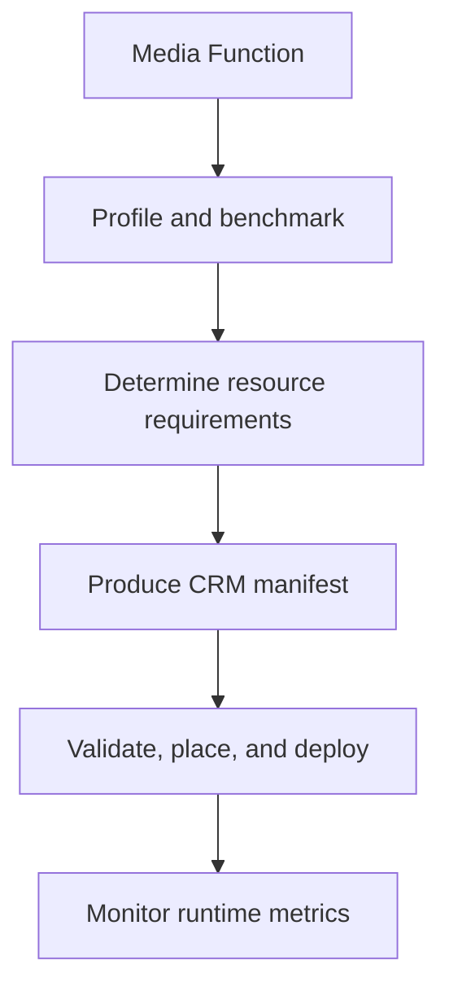

# Overview

JT-DMF Compute Resource Management (CRM) defines a platform-agnostic way for a Media Function to declare the resources it needs to run safely and predictably.

A CRM manifest describes compute, memory, storage, networking, accelerator, and other infrastructure requirements without coupling the Media Function to a particular hardware platform, cloud provider, container runtime, or orchestration technology.

## Architecture

CRM connects design-time resource specification with runtime orchestration, deployment, and operational monitoring across four architectural tiers:

- **Application and UI tier:** High-level media workloads composed of one or more modular applications.
- **Media Functions tier:** Discrete Media Functions with a Media Function Descriptor and manifest schema as the contract definition.
- **Container Platform tier:** Operators consume active manifests to instantiate media-processing workloads and emit Media Function Metrics.
- **Host Platform tier:** Underlying physical hardware capabilities are exposed through System Specifications to inform scheduling decisions.

Cross-tier orchestration and monitoring services evaluate host specifications against manifest requirements, select execution environments, deploy workloads, and track runtime metrics.

The architecture is illustrated in the [JT-DMF high-level architecture](https://github.com/AMWA-TV/jt-dmf-crm/blob/main/documentation/JT-DMF-High-Level.pdf).

## Workflow

The workflow bases resource requirements on measured behavior rather than assumptions or platform-specific deployment configuration.

## Benefits

A standardized CRM manifest enables:

- Vendors to describe resource requirements independently of the target platform.
- Orchestrators to make informed placement and scheduling decisions.
- Media Functions to be deployed consistently across heterogeneous infrastructure.
- Infrastructure providers to validate resource availability before deployment.
- Operators to achieve more predictable performance and resource utilization.
- Interoperable resource descriptions between Media Functions, platforms, and orchestration systems.
